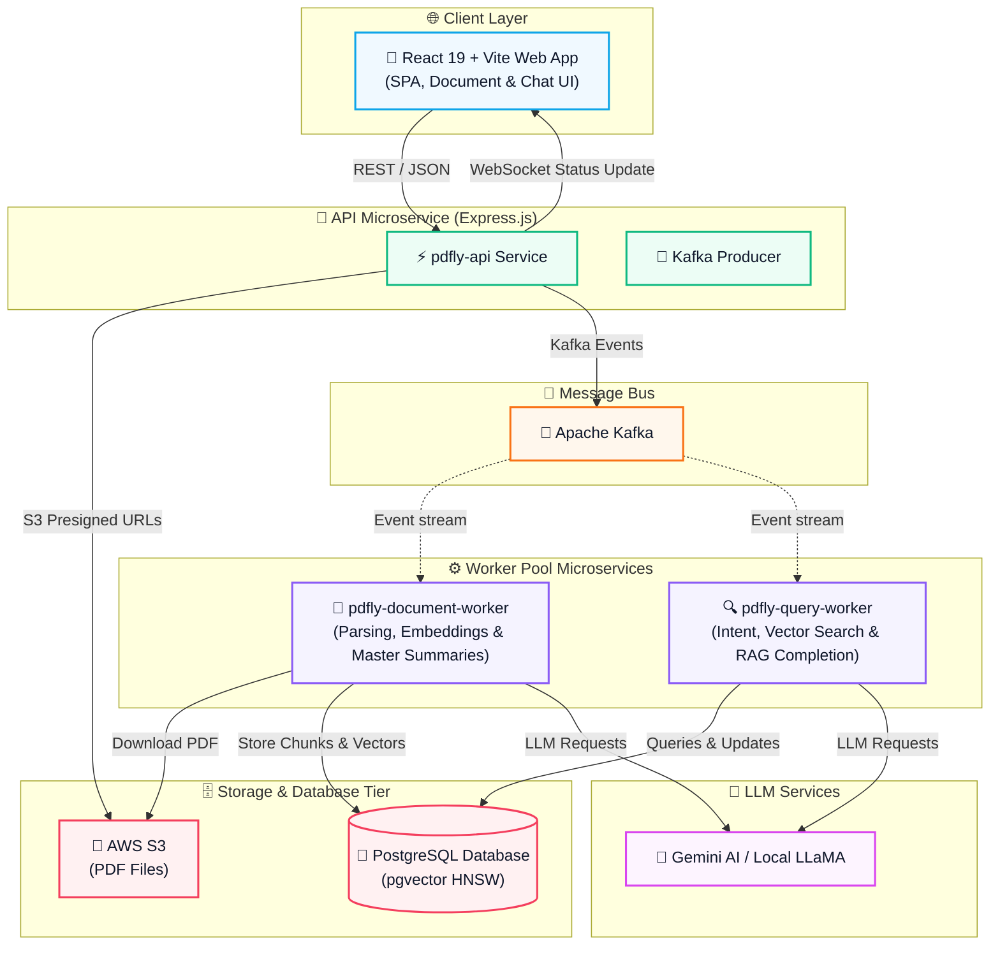
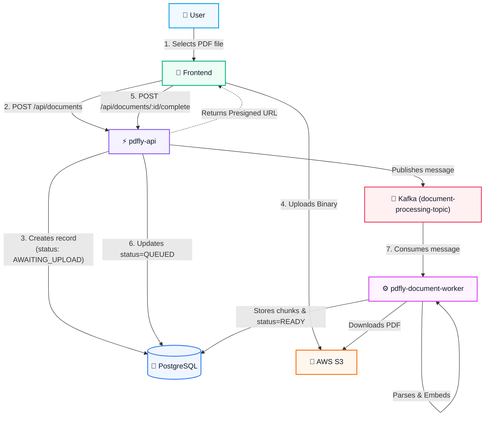
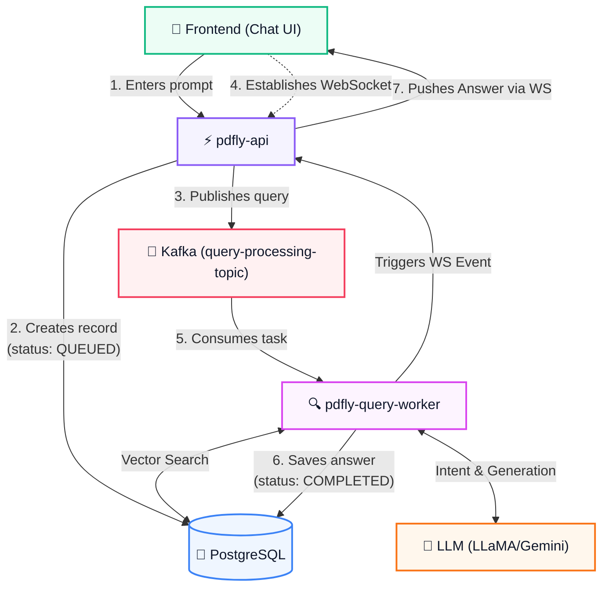

# PDFly System Architecture & Guide

PDFly is an enterprise-grade, event-driven Retrieval-Augmented Generation (RAG) platform designed for interactive PDF analysis, document querying, and automated document summarization. Built with a decoupled microservice architecture, PDFly leverages vector search capabilities, asynchronous message queues, and high-performance frontend interfaces to process complex PDF documents seamlessly.

---

## 🏗️ High-Level System Architecture

The following diagram illustrates the complete data flow and interaction between the frontend, API service, message broker, background processing workers, vector database, S3 storage, and external LLM services.



---

## 🧩 Microservice Components & Responsibilities

### 1. Frontend Client (`frontend`)
- **Tech Stack**: React 19, Vite, Tailwind CSS v4, Lucide Icons, Axios.
- **Responsibilities**:
  - User authentication interface (Signup / Login with JWT storage).
  - PDF document upload manager (Presigned S3 URL upload flow).
  - Interactive document drawer & document state tracking (Status updates via WebSocket connection for `AWAITING_UPLOAD`, `QUEUED`, `PROCESSING`, `READY`, `FAILED` to reduce latency).
  - RAG Chat interface with multi-turn conversation support and history management.
  - Responsive design with dark/light themes.

### 2. API Microservice (`backend/api`)
- **Tech Stack**: Node.js (ES Modules), Express.js, Multer, `@aws-sdk/client-s3`, KafkaJS, `pg` (PostgreSQL client), `jsonwebtoken`.
- **Port**: Default `5000`
- **Responsibilities**:
  - Authentication controller (`/api/auth/signup`, `/api/auth/login`).
  - Document ingestion management (Generates S3 presigned URLs, confirms upload completion, publishes jobs to Kafka).
  - Query management (Queues user questions to Kafka, uses WebSocket connections to stream async answers and reduce latency).
  - Document listing, single document retrieval, retry handler, and document deletion.
  - Automated retention management (Daily cron/interval task purging records older than 30 days).

### 3. Document Processing Worker (`backend/document-worker`)
- **Tech Stack**: Node.js, KafkaJS, `@xenova/transformers`, `pdf-parse`, AWS S3 Client, Local LLaMA / Gemini AI.
- **Topic**: `document-processing-topic`
- **Responsibilities**:
  - Consumes document upload events asynchronously.
  - Downloads binary PDF directly from AWS S3.
  - Validates document headers (`%PDF-`).
  - Extracts text content using `pdf-parse`.
  - Splits document text into overlapping semantic chunks.
  - Generates 384-dimensional dense vector embeddings per chunk using `@xenova/transformers` (`all-MiniLM-L6-v2`).
  - Uses a local LLaMA model to create a short summary of each chunk, then combines those chunks and sends them to the local model again to create a meta/master summary (saving on external Google API token costs).
  - Executes atomic PostgreSQL transactions to persist chunks, vector embeddings, and summary into the `documents` table, marking document status as `READY`.

### 4. RAG Query Worker (`backend/query-worker`)
- **Tech Stack**: Node.js, KafkaJS, `@xenova/transformers`, `pg`, Local LLaMA / Gemini AI.
- **Topic**: `query-processing-topic`
- **Responsibilities**:
  - Consumes incoming user query tasks asynchronously.
  - Classifies user intent (`SUMMARY`, `CONVERSATION`, `RETRIEVAL`) using a few-shot prompt technique to determine the user's intent and a confidence rating. If the confidence rating is below 50%, the model responds that it is not sure rather than hallucinating. (Note: Intent classification and response generation can utilize local models to save on external API token costs).
  - Computes dense 384-dimensional query vector embedding.
  - Performs HNSW cosine similarity search (`<=>`) against PostgreSQL `document_chunks` table scoped to the target document and user ID. (Future versions may incorporate hybrid and semantic searches).
  - Assembles prompt context (System prompt, top 5 matching text chunks or master summary, recent conversation history).
  - Calls Gemini AI (or a configured local model) for accurate response generation.
  - Updates query record status to `COMPLETED` with generated answer text.

---

## 🗄️ Database Schema & Vector Indexing

The PostgreSQL database utilizes the `pgvector` extension for efficient vector storage and similarity retrieval.

### Tables Overview

#### `users`
| Column | Type | Constraints | Description |
|---|---|---|---|
| `id` | `SERIAL` | `PRIMARY KEY` | User identifier |
| `username` | `TEXT` | `UNIQUE, NOT NULL` | Login username |
| `password_hash` | `TEXT` | `NOT NULL` | Hashed password |
| `created_at` | `TIMESTAMP` | `DEFAULT CURRENT_TIMESTAMP` | Account creation timestamp |

#### `documents`
| Column | Type | Constraints | Description |
|---|---|---|---|
| `id` | `SERIAL` | `PRIMARY KEY` | Document identifier |
| `user_id` | `INT` | `REFERENCES users(id) ON DELETE CASCADE` | Owner ID |
| `filename` | `TEXT` | `NOT NULL` | Original filename |
| `storage_key` | `TEXT` | | S3 object key |
| `status` | `VARCHAR(50)` | `DEFAULT 'AWAITING_UPLOAD'` | Status (`AWAITING_UPLOAD`, `QUEUED`, `PROCESSING`, `READY`, `FAILED`) |
| `summary` | `TEXT` | | Pre-computed Master Summary |
| `created_at` | `TIMESTAMP` | `DEFAULT CURRENT_TIMESTAMP` | Upload timestamp |
| `expires_at` | `TIMESTAMP` | `DEFAULT (CURRENT_TIMESTAMP + INTERVAL '30 days')` | Retention purge date |

#### `document_chunks`
| Column | Type | Constraints | Description |
|---|---|---|---|
| `id` | `SERIAL` | `PRIMARY KEY` | Chunk identifier |
| `document_id` | `INT` | `REFERENCES documents(id) ON DELETE CASCADE` | Parent document |
| `chunk_index` | `INT` | `NOT NULL` | Segment sequence index |
| `content` | `TEXT` | `NOT NULL` | Raw text segment |
| `embedding` | `VECTOR(384)` | | Dense embedding vector (`all-MiniLM-L6-v2`) |

#### `queries`
| Column | Type | Constraints | Description |
|---|---|---|---|
| `id` | `SERIAL` | `PRIMARY KEY` | Query identifier |
| `user_id` | `INT` | `REFERENCES users(id) ON DELETE CASCADE` | Asking user |
| `document_id` | `INT` | `REFERENCES documents(id) ON DELETE CASCADE` | Target document |
| `conversation_id` | `TEXT` | `NOT NULL` | Session/Conversation grouping |
| `query` | `TEXT` | `NOT NULL` | User question |
| `answer` | `TEXT` | | Generated answer |
| `status` | `VARCHAR(50)` | `DEFAULT 'QUEUED'` | Status (`QUEUED`, `PROCESSING`, `COMPLETED`, `FAILED`) |
| `created_at` | `TIMESTAMP` | `DEFAULT CURRENT_TIMESTAMP` | Query timestamp |
| `completed_at` | `TIMESTAMP` | | Completion timestamp |
| `expires_at` | `TIMESTAMP` | `DEFAULT (CURRENT_TIMESTAMP + INTERVAL '30 days')` | Expiration date |
| `error` | `TEXT` | | Error description if failed |

### Vector Index Configuration
PDFly uses HNSW (Hierarchical Navigable Small World) indexing for fast cosine similarity search:
```sql
CREATE INDEX IF NOT EXISTS document_chunks_embedding_hnsw_idx 
ON document_chunks USING hnsw (embedding vector_cosine_ops);
```

---

## 🔄 End-to-End Execution Flows

### Document Ingestion Flow


### RAG Query & Chat Flow


---

## 🌐 API Endpoint Reference

| Method | Endpoint | Description | Auth Required |
|---|---|---|---|
| `POST` | `/api/auth/signup` | Create user account | No |
| `POST` | `/api/auth/login` | Authenticate & get JWT token | No |
| `GET` | `/api/documents` | List all user documents | Yes |
| `GET` | `/api/documents/:id` | Fetch document details & status | Yes |
| `POST` | `/api/documents` | Initiate PDF upload (presigned URL) | Yes |
| `POST` | `/api/documents/:id/complete` | Confirm upload completion & queue processing | Yes |
| `POST` | `/api/documents/:id/retry` | Retry failed document processing | Yes |
| `DELETE` | `/api/documents/:id` | Delete document and associated chunks | Yes |
| `POST` | `/api/documents/:documentId/query` | Submit query scoped to a document | Yes |
| `POST` | `/api/query` | Submit general query | Yes |
| `WS` | `/api/ws` | WebSocket connection for real-time status and query results (replaces polling) | Yes |
| `GET` | `/api/models` | List configured AI models | Yes |
| `GET` | `/api/chat-history` | Fetch historical chat conversations | Yes |
| `DELETE` | `/api/chat-history` | Wipe user chat history | Yes |


---

## 🚀 Running the Platform Locally

### Prerequisites
- Node.js (v18+)
- PostgreSQL with `pgvector` extension enabled
- Apache Kafka instance
- AWS S3 bucket or S3-compatible emulator (LocalStack / MinIO)

### Startup Sequence
1. **Database & Kafka**: Ensure PostgreSQL and Kafka services are running.
2. **API Microservice**:
   ```bash
   cd backend/api
   npm install
   npm run dev
   ```
3. **Document Worker**:
   ```bash
   cd backend/document-worker
   npm install
   npm run dev
   ```
4. **Query Worker**:
   ```bash
   cd backend/query-worker
   npm install
   npm run dev
   ```
5. **Frontend Application**:
   ```bash
   cd frontend
   npm install
   npm run dev
   ```
